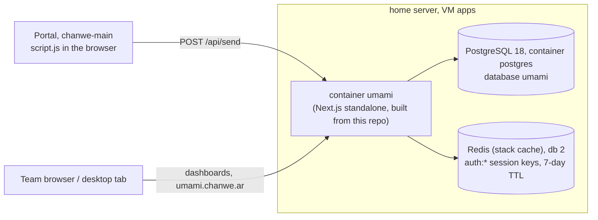
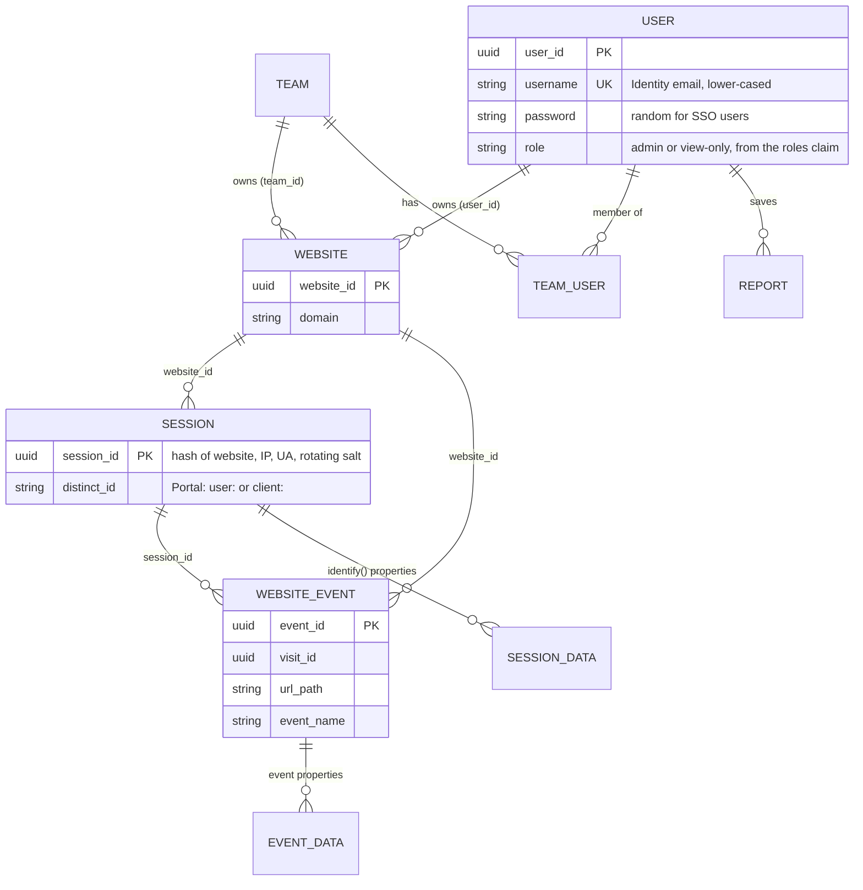
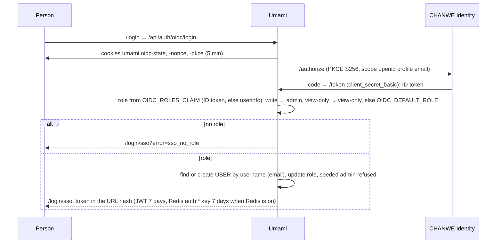
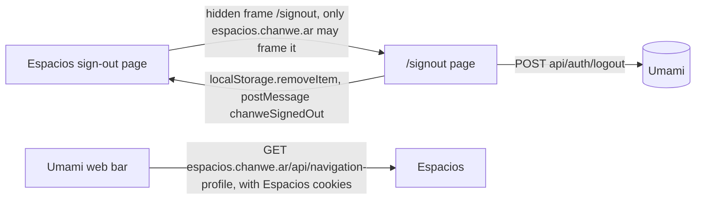

# Data tree: CHANWE's Umami

[Español](../es/data-tree.md) · Checked against the code on **2026-11-03** (`prisma/schema.prisma`, `src/lib/oidc.ts`,
`src/app/api/auth/oidc/callback/route.ts`, `src/lib/auth.ts`, `src/app/signout/route.ts`, the Portal's
`src/lib/umami.ts`, `chanwe-main/js/components.js`, `chanwe-proxmox-server/stacks/umami`). Live data, the website rows
and the server's `.env` (role mapping) were not checked.

The schema is Umami's (Prisma, migrations in `prisma/migrations`, applied at container start by `scripts/check-db.js`).
CHANWE adds **no tables or columns**.

## 1. Where the data lives



## 2. Main entities and keys



## 3. Where the analytics data comes from

```mermaid
flowchart TB
  P["Portal (portal.chanwe.ar)<br/>src/lib/umami.ts"] -->|script.js, data-website-id bc0062cb…, data-domains portal.chanwe.ar| S["/api/send"]
  M["Public site (chanwe.ar)<br/>js/components.js"] -->|script.js, same website id, track() events| S
  P -->|"identify(): id user:/client:, client_id, user_kind, auth_method, organization_id"| S
  S --> SE[(SESSION / SESSION_DATA)]
  S --> WE[(WEBSITE_EVENT / EVENT_DATA)]
```

The Portal skips tracking on localhost and in admin previews (`authMethod === "admin-preview"`). Both sites post to the same
website id in the code read on 2026-11-03.

## 4. Sign-in: where an Umami user comes from



The token lives in the browser's `localStorage` (key `umami.auth`) and is sent as `Authorization: Bearer`.

## 5. Sign-out and who reads what



| Data | Source | Writer | Readers |
|---|---|---|---|
| Sessions, events, event and session properties | Portal and public site visitors | `/api/send` | Team dashboards |
| Users, roles | Identity's claims at sign-in | OIDC callback | Umami |
| Session token | Callback | Umami (JWT, Redis key) | Umami; removed by `/signout` |
| Account preview (photo, roles) | Espacios `/api/navigation-profile` | Espacios | Umami's web bar, in the browser only |
| Brand files | `chanwe-brandbook` | `pnpm brand:sync` | Build |
| Secrets (`APP_SECRET`, `TWO_FACTOR_ENCRYPTION_KEY`, `OIDC_CLIENT_SECRET`, DB password) | Server stack `.env`, chanwe-locker | Ale | Container |
