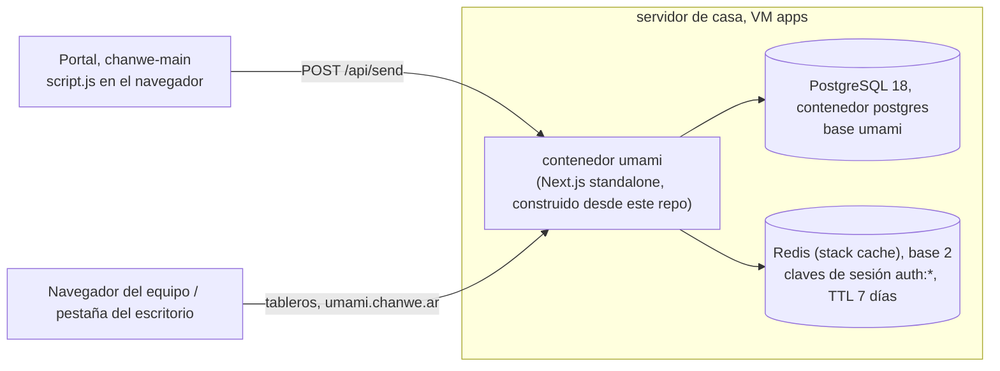
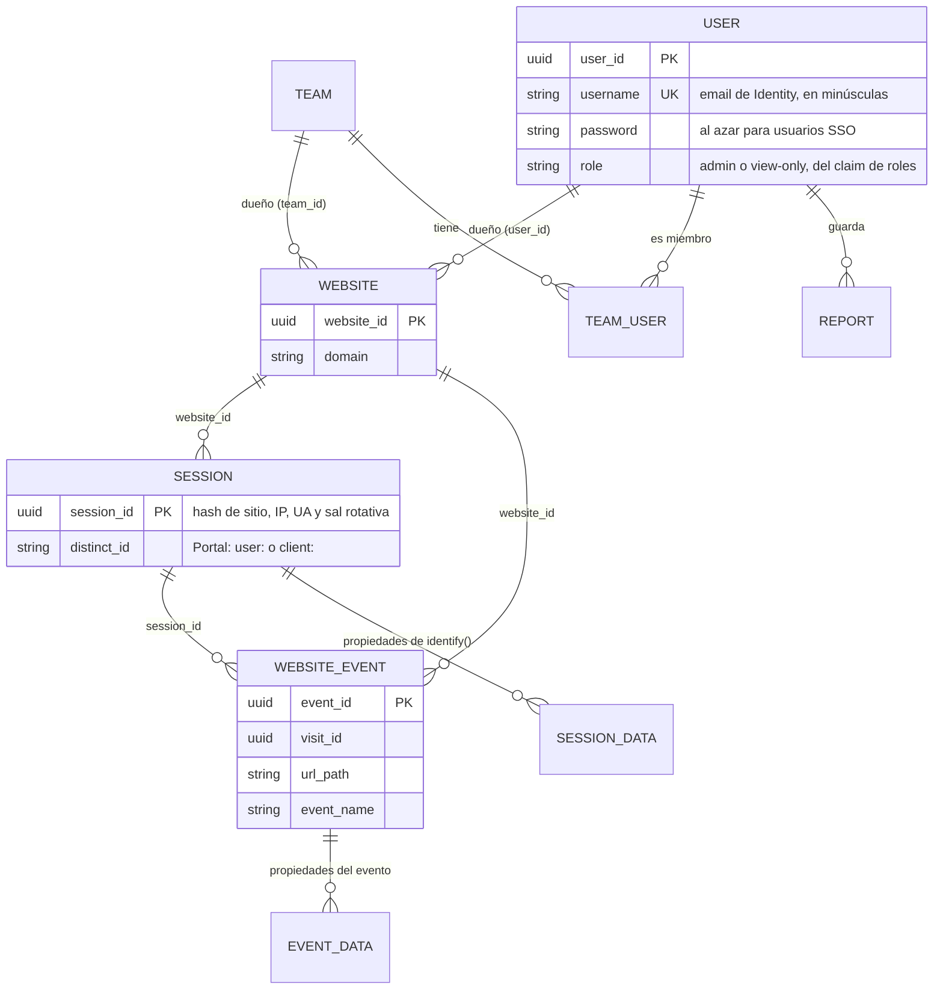
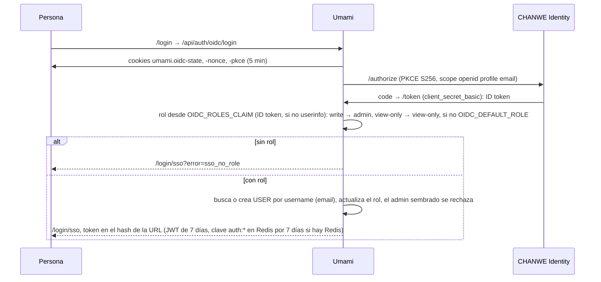
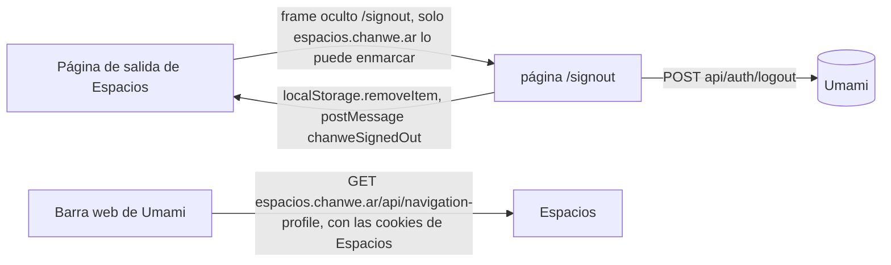

# Árbol de datos: el Umami de CHANWE

[English](../en/data-tree.md) · Revisado contra el código el **2026-11-03** (`prisma/schema.prisma`, `src/lib/oidc.ts`,
`src/app/api/auth/oidc/callback/route.ts`, `src/lib/auth.ts`, `src/app/signout/route.ts`, `src/lib/umami.ts` del Portal,
`chanwe-main/js/components.js`, `chanwe-proxmox-server/stacks/umami`). No revisé datos en vivo, las filas de `website` ni
el `.env` del servidor (el mapeo de roles).

El esquema es de Umami (Prisma, migraciones en `prisma/migrations`, aplicadas al arrancar el contenedor por
`scripts/check-db.js`). CHANWE **no agrega tablas ni columnas**.

## 1. Dónde viven los datos



## 2. Entidades principales y claves



## 3. De dónde salen los datos de analítica

```mermaid
flowchart TB
  P["Portal (portal.chanwe.ar)<br/>src/lib/umami.ts"] -->|script.js, data-website-id bc0062cb…, data-domains portal.chanwe.ar| S["/api/send"]
  M["Sitio público (chanwe.ar)<br/>js/components.js"] -->|script.js, mismo website id, eventos track()| S
  P -->|"identify(): id user:/client:, client_id, user_kind, auth_method, organization_id"| S
  S --> SE[(SESSION / SESSION_DATA)]
  S --> WE[(WEBSITE_EVENT / EVENT_DATA)]
```

El Portal no mide en localhost ni en las vistas previas de admin (`authMethod === "admin-preview"`). En el código leído
el 2026-11-03, los dos sitios mandan al mismo website id.

## 4. Entrada: de dónde sale un usuario de Umami



El token queda en el `localStorage` del navegador (clave `umami.auth`) y viaja como `Authorization: Bearer`.

## 5. Salida y quién lee qué



| Dato | Origen | Quién lo escribe | Quién lo lee |
|---|---|---|---|
| Sesiones, eventos, propiedades de evento y sesión | Visitas al Portal y al sitio público | `/api/send` | Tableros del equipo |
| Usuarios, roles | Claims de Identity al entrar | Callback OIDC | Umami |
| Token de sesión | Callback | Umami (JWT, clave en Redis) | Umami; lo borra `/signout` |
| Vista de la cuenta (foto, roles) | `/api/navigation-profile` de Espacios | Espacios | La barra web de Umami, solo en el navegador |
| Archivos de marca | `chanwe-brandbook` | `pnpm brand:sync` | El build |
| Secretos (`APP_SECRET`, `TWO_FACTOR_ENCRYPTION_KEY`, `OIDC_CLIENT_SECRET`, clave de la base) | `.env` del stack, chanwe-locker | Ale | El contenedor |
